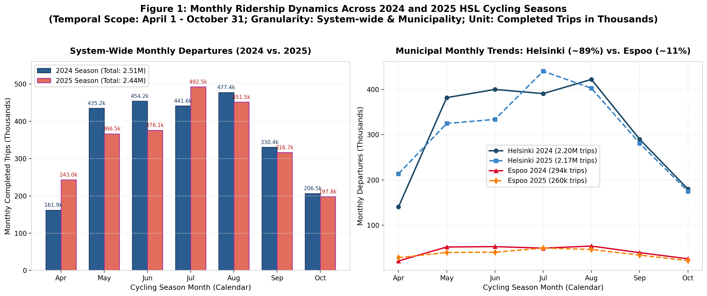
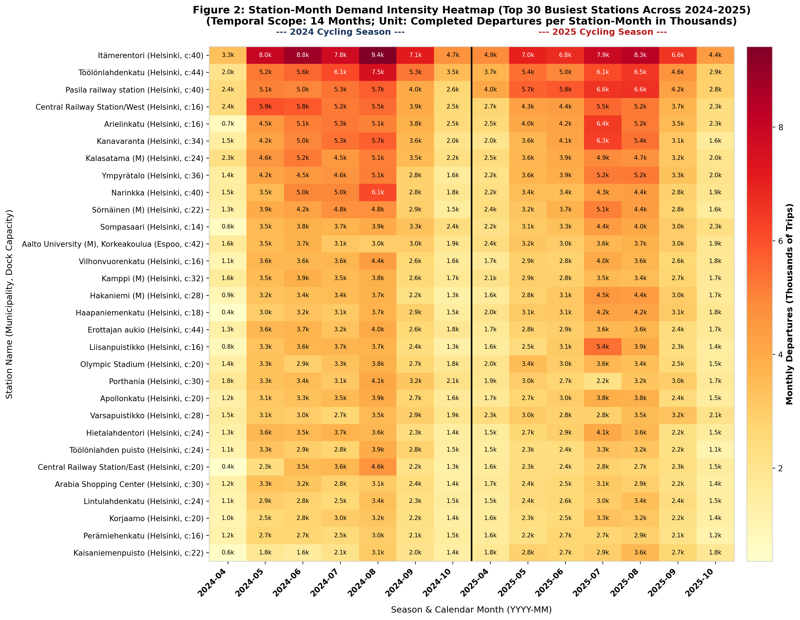
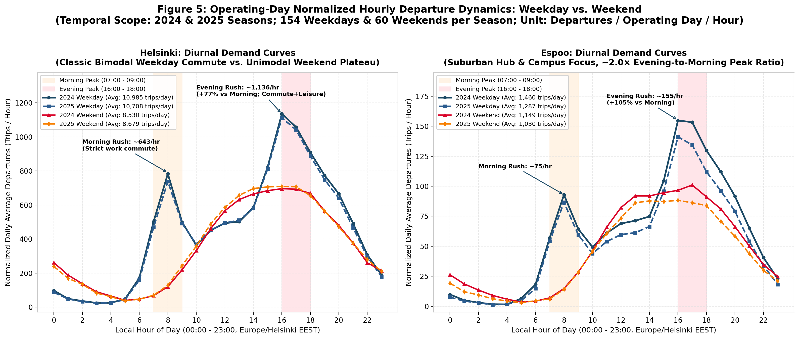
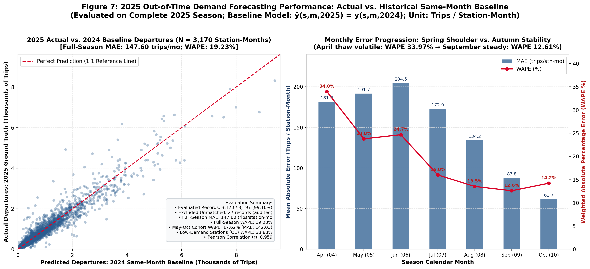
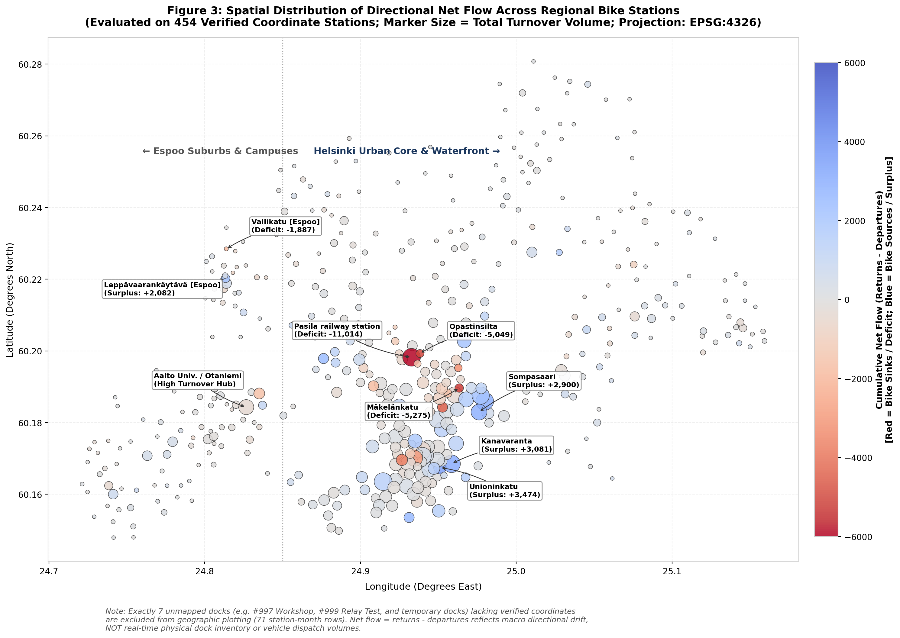
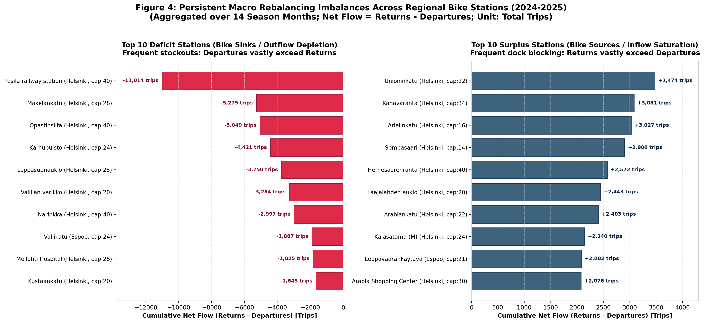
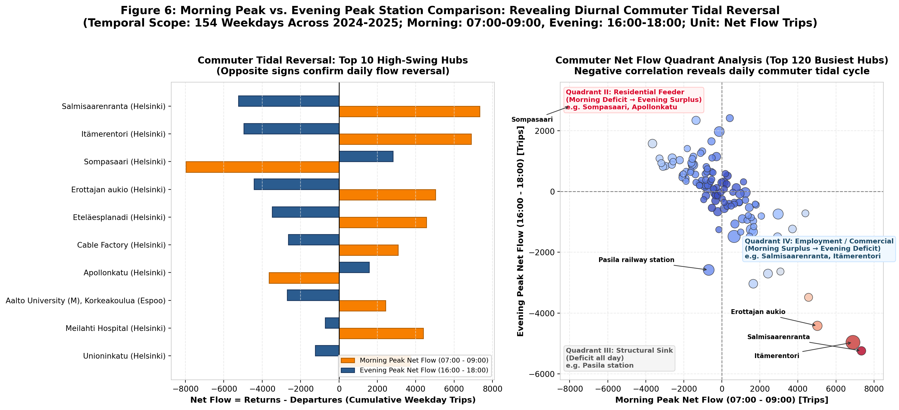

# Seasonal and Weather-Based HSL City Bike Allocation: Comprehensive Project Findings Report

- **Course Project**: Seasonal and Weather-Based HSL City Bike Allocation (Canvas Workshop 3)
- **Authors**: Chenyu Wu, Jizhou Wang, Jussi Honkio
- **Temporal Scope**: Two complete cycling seasons (**2024 and 2025**, April 1 – October 31 each; 14 months total)
- **Target Audience**: City-bike fleet operators and HSL transport planners
**Repository Deliverables**:
- Analytical Source Code: [`src/clean_and_aggregate.py`](../src/clean_and_aggregate.py), [`src/download_data.py`](../src/download_data.py), [`src/generate_figures.py`](../src/generate_figures.py)
- Verified Analysis Notebooks:
  - [`notebooks/weather_eda.ipynb`](../notebooks/weather_eda.ipynb): Daily trip volume and FMI weather observations exploratory analysis
  - [`notebooks/demand_baseline.ipynb`](../notebooks/demand_baseline.ipynb): Historical same-month baseline demand forecasting (2024 $\to$ 2025)
  - [`notebooks/model_comparison.ipynb`](../notebooks/model_comparison.ipynb): Methodologically leakage-free within-season model comparison
  - [`notebooks/intraday_traffic_eda.ipynb`](../notebooks/intraday_traffic_eda.ipynb): Weekday/weekend diurnal curves, peak hour commuter dynamics, and spatial heterogeneity
- Publication Figures Gallery: [`reports/figures/`](figures/)

---

## 1. Research Questions

Grounded in [HSL_City_Bike_Project_Canvas.md](../HSL_City_Bike_Project_Canvas.md), this project investigates four core research questions to support fleet allocation and rebalancing strategies across the Helsinki Capital Region (Helsinki and Espoo):

1. **Seasonal & Climatological Dynamics**: How does station-level and municipal bike demand evolve across the 7-month operating season (April to October), and how strongly does daily trip volume correlate with ground-truth temperature and precipitation observations?
2. **Intraday & Weekday/Weekend Regimes**: How does mobility demand diverge between workdays and leisure weekends? To what extent do morning (07:00–09:00) and evening (16:00–18:00) commuter rushes exhibit directional volume asymmetries that monthly aggregates hide?
3. **Out-of-Time Demand Predictability**: Can a historical same-month baseline (using 2024 to predict 2025) provide a reliable demand benchmark for departures and returns? How does it compare against regularized linear regression (Ridge) and decision trees when restricted to causal within-season lag signals without lookahead bias?
4. **Rebalancing Priority & Network Bottlenecks**: Which bike stations exhibit persistent, severe directional flow imbalances (`net_flow = returns - departures`), and how should planners prioritize stations facing bike stockouts (sinks) or dock saturation (sources)?

---

## 2. Data & Methodology

### 2.1 Data Sources & Ingestion Scope
- **HSL Origin-Destination (OD) Journey Records**:
  - Ingested across 14 monthly files from the official HSL Open Data repository (`dev.hsl.fi/citybikes/od-trips-[year]/`).
  - **Raw Ingested Records**: 5,102,233 trips (2,585,668 in 2024; 2,516,565 in 2025).
  - **Clean Valid Records Retained**: **4,951,245 trips** (2,507,175 in 2024, 96.96% retention; 2,444,070 in 2025, 97.12% retention; **overall retention rate: 97.04%**).
- **Data Quality Filtering Criteria**:
  1. *Trip Duration*: $10\text{s} \le \text{Duration} \le 86,400\text{s}$ (24 hours), discarding instant checkout errors and unreturned/lost bikes;
  2. *Trip Distance*: $\text{Covered Distance} \ge 10\text{m}$, eliminating stationary dock-sensor tests;
  3. *Speed Boundary*: $\text{Average Speed} \le 10.0\text{ m/s}$ (~$36\text{ km/h}$), filtering motorized vehicles and GPS teleportation glitches;
  4. *Chronology*: $\text{Return Timestamp} \ge \text{Departure Timestamp}$.
- **Station Metadata & Geographic Layer**: Official HSL ArcGIS REST feature service covering 457 active stations with English/Finnish/Swedish names, capacity, and WGS84 coordinates.
- **FMI Ground Weather Observations**: Retrospective actual daily observations sourced via the Finnish Meteorological Institute (Ilmatieteen laitos) WFS API for Helsinki Kaisaniemi (FMISID 100971) and Espoo Tapiola (FMISID 874863). Coverage across all 428 season calendar days is 100% complete across all 5 parameters (mean, min, max temperature, precipitation, snow depth). FMI `-1.0` code denotes dry conditions ($0.0\text{ mm}$).
- **Timezone Standardization**: All timestamps converted to local Finnish time (`Europe/Helsinki`, EEST in summer, UTC+3).
- **Temporal Alignment**: Each 214-day cycling season consists of exactly **154 weekdays** and **60 weekend days**. Metrics are reported as **Operating-Day Normalized Daily Averages** ($\text{trips} / \text{days}$) to eliminate calendar bias.

### 2.2 Handling of Missing Data & Unmapped Stations
- **Unmapped Docks**: 4 stations in 2024 (IDs 710, 768, 997, 999; 26 rows) and 7 stations in 2025 (IDs 626, 710, 716, 754, 768, 997, 999; 45 rows) represent maintenance depots (e.g., #997 Workshop, #999 Relay Box test station) or temporary docks absent from the active ArcGIS layer. Coordinates and municipalities are **strictly preserved as `NaN` rather than silently imputed**. Unmapped docks are excluded from map figures.
- **Midnight-Crossing Trips**: 21,532 trips (0.86%) in 2024 and 19,957 trips (0.82%) in 2025 departed on date $D_1$ and returned on date $D_2$. Departures are attributed to $D_1$ at origin; returns to $D_2$ at destination.
- **Missing Baseline Counterparts**: In the 2025 out-of-time evaluation, 27 records lacking 2024 counterparts were audited and excluded without zero imputation (99.16% coverage).

---

## 3. Key Empirical Findings

### 3.1 Seasonal Trajectory & Municipal Divergence
System ridership exhibits a sharp unimodal seasonal envelope governed by high-latitude daylight and climate:
- **Season Volume**: 2,507,175 trips in 2024 vs. 2,444,070 trips in 2025 (-2.5% YoY).
- **Peak vs. Shoulder**: Ridership peaks in July/August (~450k–492k trips/month) and contracts sharply during the shoulder months (April: 162k–243k; October: 198k–207k).
- **Helsinki vs. Espoo Split**: Helsinki commands **88.8%** of total regional trips (2.20M in 2024; 2.17M in 2025), driven by dense downtown corridors and multi-modal transit hubs. Espoo commands **11.2%** (294k in 2024; 260k in 2025), anchored by suburban West Metro stations and university hubs (Otaniemi/Tapiola).

### 3.2 Station-Month Demand Intensity Heatmap
Tracking the Top 30 busiest bike stations across all 14 months demonstrates consistent spatial hierarchy:
- High-volume transit anchors (e.g., *Itämerentori* in Ruoholahti, *Töölönlahdenkatu*, *Pasila railway station*, *Central Railway Station*, *Kalasatama*) maintain sustained monthly volume exceeding 5,000–9,000 departures during June–August.
- Peripheral and suburban stations exhibit heightened vulnerability to autumn cooldown in September and October.

### 3.3 Descriptive Correlation with Ground Weather Observations
Evaluating 214 daily observations in 2025 against ground-truth FMI actual weather:
- **Temperature Association**: Daily departures exhibit strong positive linear correlation with mean daily temperature ($r = +0.737$ in Helsinki, $r = +0.665$ in Espoo) and maximum temperature ($r = +0.788$ in Helsinki, $r = +0.751$ in Espoo).
- **Precipitation Association**: Daily departures correlate moderately negatively with precipitation ($r = -0.251$ in Helsinki, $r = -0.289$ in Espoo).
- **Climatological Confounding**: While warmer and drier days coincide with higher cycling, temperature co-moves with daylight duration (19 hours in June vs. 9 hours in October), university terms, and summer holiday schedules. These correlations are **strictly descriptive associations, not direct causal effects**.

### 3.4 Weekday vs. Weekend Diurnal Profiles
Normalizing by active operating days (154 weekdays, 60 weekend days per season) reveals distinct behavioral curves:
- **Operating-Day Normalized Daily Departures**:
  - *2024 Helsinki*: Weekday 10,985.4 trips/day vs. Weekend 8,530.3 trips/day (+28.8% on weekdays);
  - *2024 Espoo*: Weekday 1,460.4 trips/day vs. Weekend 1,149.4 trips/day (+27.1% on weekdays);
  - *2025 Helsinki*: Weekday 10,708.2 trips/day vs. Weekend 8,678.6 trips/day (+23.4% on weekdays);
  - *2025 Espoo*: Weekday 1,287.2 trips/day vs. Weekend 1,030.4 trips/day (+24.9% on weekdays).
- **Diurnal Morphology**:
  - **Weekdays**: Pronounced bimodal commute curve with a sharp morning spike at 08:00 (~643–790 trips/hr in Helsinki) and a broad evening plateau between 16:00 and 18:00 (~1,112–1,136 trips/hr).
  - **Weekends**: Unimodal daytime plateau spanning 12:00 to 17:00 (~600–710 trips/hr in Helsinki), reflecting leisure and recreational travel without morning commute rush.

### 3.5 Commuter Peak Asymmetry (Morning vs. Evening)
Comparing standardized 2-hour peak windows on weekdays:
- **Morning Peak**: 07:00–09:00 (Hours 7 & 8);
- **Evening Peak**: 16:00–18:00 (Hours 16 & 17).
- **The Evening Surge (+70% to +105%)**:
  - *Helsinki 2024*: Morning 1,286.8 trips/day vs. Evening 2,193.8 trips/day (**+70.5% higher in evening**);
  - *Helsinki 2025*: Morning 1,207.5 trips/day vs. Evening 2,154.4 trips/day (**+78.4% higher in evening**);
  - *Espoo 2024*: Morning 150.1 trips/day vs. Evening 308.2 trips/day (**+105.4% higher in evening**);
  - *Espoo 2025*: Morning 140.7 trips/day vs. Evening 275.6 trips/day (**+95.9% higher in evening**).
- **Behavioral Driver**: Morning trips are strictly utilitarian commute journeys from home to work/transit hubs. Evening trips combine homeward commutes with dining, shopping, leisure, and social activities under extended northern daylight.
- **Operational Working Hypothesis (Subject to Dock Inventory Data)**: Because departures surge sharply between 16:00 and 18:00, planners could explore an operational hypothesis of pre-staging bicycle redistribution prior to the afternoon peak (e.g., before 15:30); verifying this strategy requires real-time dock occupancy records.

---

## 4. Predictive Modeling & Baseline Results

### 4.1 Historical Same-Month Baseline (Full 2025 Season)
The baseline model forecasts 2025 demand using the identical station's volume from the same calendar month in 2024:
$$\hat{y}_{s,m,2025} = y_{s,m,2024}$$
Evaluated across all 3,170 matched test station-months in 2025:

| Target Metric | Evaluated Rows ($N$) | MAE (trips/stn·mo) | WAPE (%) | RMSE (trips) | Median AE (trips) | Pearson $r$ |
| :--- | :---: | :---: | :---: | :---: | :---: | :---: |
| **Departures (Rentals)** | 3,170 | **147.60** | **19.23%** | 270.87 | 73.0 | 0.959 |
| **Returns (Dockings)** | 3,170 | **145.99** | **19.02%** | 272.08 | 71.0 | 0.959 |

- **Monthly Error Trajectory**:
  - *April (Opening Shoulder)*: High error due to year-to-year spring thaw variability (WAPE 33.97%, MAE 181.57 trips);
  - *May–June (Spring Transition)*: WAPE stabilizes to 23.8%–24.7%;
  - *July–August (Peak Season)*: WAPE decreases to 16.00% (July) and 13.53% (August);
  - *September–October (Autumn Closing)*: Highest accuracy (September WAPE 12.61%, MAE 87.76 trips; October WAPE 14.22%, MAE 61.68 trips).

### 4.2 Leakage-Free Within-Season Model Comparison (Solution B)
To evaluate machine learning models under realistic operational conditions:
- **Decision Epoch**: At the start of month $m$, operators observe completed ridership from month $m-1$ and forecast month $m$ (evaluated on months 5–10, May to October).
- **Zero Weather Lookahead**: 2025 ground-truth weather is strictly excluded from predictive features.
- **Exact Features (10 Dimensions)**: Prior-month lag (`lag_departures` or `lag_returns`), `capacity`, `latitude`, `longitude`, `is_helsinki`, and month indicators (`m_6` to `m_10`).
- **Unified Test Cohort**: Evaluated across identical $N = 2,718$ test station-months.

| Performance Dimension | 1. Same-Month Baseline (2024) | 2. Ridge Regression ($\alpha=10$) | 3. Decision Tree (`depth=6`) |
| :--- | :---: | :---: | :---: |
| **Departures MAE (trips/mo)** | **141.88** | 226.01 | 199.53 |
| **Departures WAPE (%)** | **17.58%** | 28.00% | 24.72% |
| **Returns MAE (trips/mo)** | **139.73** | 226.52 | 195.63 |
| **Returns WAPE (%)** | **17.31%** | 28.06% | 24.23% |
| **Low-Demand Stations WAPE (Q1 $\le$ 198 trips, $N=681$)** | **33.83%** (MAE: 41.92) | 124.07% (MAE: 153.74) | 55.98% (MAE: 69.37) |
| **Top-20 Deficit Overlap Range** | 40% – 75% (Avg: 60.8%) | **60% – 80% (Avg: 69.2%)** | 25% – 40% (Avg: 31.7%) |
| **Top-20 Surplus Overlap Range** | 35% – 75% (Avg: 53.3%) | **60% – 75% (Avg: 65.8%)** | 25% – 35% (Avg: 30.8%) |
| **Spearman Rank Correlation ($\rho$) Range** | 0.483 – 0.663 (Avg: 0.582) | **0.455 – 0.761 (Avg: 0.650)** | 0.123 – 0.358 (Avg: 0.242) |

### 4.3 Model Comparison Takeaways
1. **For Absolute Demand Volume: Historical Baseline Shows Lowest Error**:
   The historical same-month baseline achieves **17.58% WAPE**, outperforming Decision Tree (24.72%) and Ridge (28.00%). In Helsinki's subarctic climate, month-to-month transitions involve sharp climatological shifts (April thaw $\to$ May summer warmup; August warmth $\to$ September autumn chill). Preceding-month lag models suffer from transitional delay, whereas the previous year's same month naturally aligns with solar irradiance, seasonal temperature, and academic/commuter calendars.
2. **Ridge Failure on Low-Usage Stations**:
   On bottom-quartile stations (Q1 $\le 198$ trips/month), Ridge exhibits an inflated WAPE of **124.07%**. Global month dummy coefficients force rigid absolute intercept shifts, causing large relative over-estimation on quiet suburban docks. Baseline preserves localized dock scale (WAPE 33.83%).
3. **For High-Priority Deficit Ranking: Ridge Excels in Early/Mid-Season**:
   In May through August, Ridge captures 65%–80% of top deficit stations (capturing up to 16/20 stations, Spearman $\rho$ up to 0.761). Its smooth monotonic linear slope effectively magnifies major commuter sinks (e.g., Pasila). In September, Baseline performs better (70% vs. 60%), and both tie in October (65%).
4. **No Single Model is Universally Superior**: Demand sizing should rely on the historical baseline, while early-season deficit screening for heavy commuter sinks can reference Ridge rank ordering.

---

## 5. Station Triage & Operational Priority Review

### 5.1 Macro Net Flow Imbalances (Spatial Distribution)
Mapping cumulative net flow $\text{net\_flow} = \text{returns} - \text{departures}$ across all 454 stations with coordinates reveals strong geographic polarization:
- **Systemic Deficit Sinks (Red, Bike Depletion)**: Concentrated around major transit interchanges and radial arterials where inbound commuters arrive by train/bus and depart on city bikes.
- **Systemic Surplus Sources (Blue, Dock Congestion)**: Concentrated along scenic waterfronts, residential development clusters, and central dining districts where riders complete trips.

### 5.2 Rebalancing Allocation Priority Review List
Aggregating over all 14 season months identifies the primary operational bottlenecks:

#### Top 10 Deficit Stations (Bike Depletion / Stockout Vulnerability)
| Rank | Station ID | Station Name | Municipality | Capacity | Cumulative Net Flow | Primary Operational Rationale |
| :---: | :---: | :--- | :---: | :---: | :---: | :--- |
| **1** | 113 | Pasila railway station | Helsinki | 40 | **-11,014 trips** | Major regional train interchange; commuters disembark and bike to surrounding offices. |
| **2** | 120 | Mäkelänkatu | Helsinki | 28 | **-5,275 trips** | Arterial transit corridor sink; heavy morning and afternoon outbound departures. |
| **3** | 203 | Opastinsilta | Helsinki | 40 | **-5,049 trips** | East Pasila office/administrative complex; rapid bike exhaustion. |
| **4** | 43 | Karhupuisto | Helsinki | 24 | **-4,421 trips** | Kallio residential hub; high outbound departures downhill toward city center. |
| **5** | 162 | Leppäsuonaukio | Helsinki | 28 | **-3,750 trips** | Töölö/Kamppi edge; student housing cluster generating strong outbound trips. |
| **6** | 290 | Vallilan varikko | Helsinki | 20 | **-3,284 trips** | Office and transit hub; consistent net outflow. |
| **7** | 25 | Narinkka | Helsinki | 40 | **-2,997 trips** | Kamppi commercial center; high outbound evening demand. |
| **8** | 749 | Vallikatu | Espoo | 24 | **-1,887 trips** | Leppävaara feeder station; residential outbound commuters heading to rail station. |
| **9** | 83 | Meilahti Hospital | Helsinki | 28 | **-1,825 trips** | Major medical complex; shift-worker commute departures. |
| **10** | 87 | Kustaankatu | Helsinki | 20 | **-1,645 trips** | Kallio dense residential dock; chronic bike depletion. |

#### Top 10 Surplus Stations (Dock Saturation / Return Blocking Vulnerability)
| Rank | Station ID | Station Name | Municipality | Capacity | Cumulative Net Flow | Primary Operational Rationale |
| :---: | :---: | :--- | :---: | :---: | :---: | :--- |
| **1** | 11 | Unioninkatu | Helsinki | 22 | **+3,474 trips** | Central University/Senate Square; high inbound arrival volume. |
| **2** | 12 | Kanavaranta | Helsinki | 34 | **+3,081 trips** | Katajanokka waterfront & dining district; popular leisure trip termination dock. |
| **3** | 125 | Arielinkatu | Helsinki | 16 | **+3,027 trips** | Kalasatama residential high-rises; evening commute return destination. |
| **4** | 404 | Sompasaari | Helsinki | 14 | **+2,900 trips** | Waterfront residential pocket; compact 14-bike dock frequently saturated by evening returns. |
| **5** | 65 | Hernesaarenranta | Helsinki | 40 | **+2,572 trips** | Coastal recreational strip; weekend leisure arrivals accumulate bikes. |
| **6** | 94 | Laajalahden aukio | Helsinki | 20 | **+2,443 trips** | Munkkiniemi residential terminal dock; high evening returns. |
| **7** | 138 | Arabiankatu | Helsinki | 22 | **+2,403 trips** | Arabianranta residential and campus cluster; net inflow accumulator. |
| **8** | 126 | Kalasatama (M) | Helsinki | 24 | **+2,140 trips** | Metro station transfer hub; riders dock bikes before boarding metro. |
| **9** | 731 | Leppävaarankäytävä | Espoo | 21 | **+2,082 trips** | Leppävaara station pedestrian underpass; commuters dock bikes to catch trains. |
| **10** | 137 | Arabia Shopping Center | Helsinki | 30 | **+2,076 trips** | Retail center destination; shoppers dock bikes. |

### 5.3 Diurnal Commuter Tidal Reversal
Evaluating weekday peak hours uncovers a dramatic commuter tidal reversal between morning and evening rush hours:
- **Residential Feeders (Quadrant II)**: Docks like *Sompasaari* experience massive bike deficits during the morning rush (-7,973 net flow; 8,787 departures vs. 814 returns) as residents bike to work, but transform into major surplus accumulators during the evening rush (+2,808 net flow) as residents return home.
- **Employment & Transit Centers (Quadrant IV)**: Docks like *Salmisaarenranta* experience heavy surplus accumulation in the morning rush (+7,343 net flow; 7,543 returns vs. 200 departures), but reverse into major deficit sinks in the evening rush (-5,244 net flow) as workers unlock bikes to leave offices.
- **Persistent Structural Sinks (Quadrant III)**: *Pasila railway station* remains in deficit throughout both morning and evening rush hours (-2,618 morning, -2,607 evening), serving as an all-day transit dispersal node.

---

## 6. Limitations & Methodological Constraints

1. **Historical Actual Weather Observations $\neq$ Weather Forecasts**:
   - The weather metrics integrated into this project represent retrospective ground-truth observations recorded by FMI weather stations.
   - Ground-truth weather was **strictly excluded from all 2025 predictive models** to prevent future lookahead bias.
2. **Descriptive Associations $\neq$ Causal Claims**:
   - Observed correlations between trip volume and weather (e.g., $r \approx 0.74$ with temperature) reflect co-movement within Nordic seasons.
   - They do **not prove direct causation**. Subarctic summer daylight duration (19h in June vs. 9h in October), public school holidays, university terms, and industrial summer vacations are strongly collinear with temperature.
3. **Forecast Error Metric Unit (MAE) $\neq$ Physical Bicycle Inventory**:
   - The Mean Absolute Error (MAE) is measured in **trips per station-month** (e.g., MAE = 147.60 trips/month).
   - It **does not represent a shortage or surplus of physical bicycles**. In a sharing system, individual bicycles complete multiple trips per day.
4. **Monthly Net Flow $\neq$ Real-Time Truck Rebalancing Workloads**:
   - Cumulative monthly $\text{net\_flow} = \text{returns} - \text{departures}$ reflects macro 30-day directional passenger drift.
   - It **does not represent the number of bikes requiring immediate van dispatch**. Diurnal reverse flows partially offset daytime imbalances; operational van dispatch requires real-time (15-minute or hourly) occupancy monitoring.
5. **Single Out-of-Time Test Season (2025)**:
   - With two operating seasons (2024 and 2025), the predictive evaluation constitutes a **single out-of-time test cycle**.
   - These results represent exploratory empirical benchmarks, not definitive multi-year confidence intervals. **No claims of statistical significance or proven long-term model superiority can be made**.
6. **Quarter 4 Coverage is Partial**:
   - The HSL city-bike season runs from April 1 to October 31.
   - Consequently, **Q4 consists exclusively of October (1 month)** and represents a partial, end-of-season operational window.
